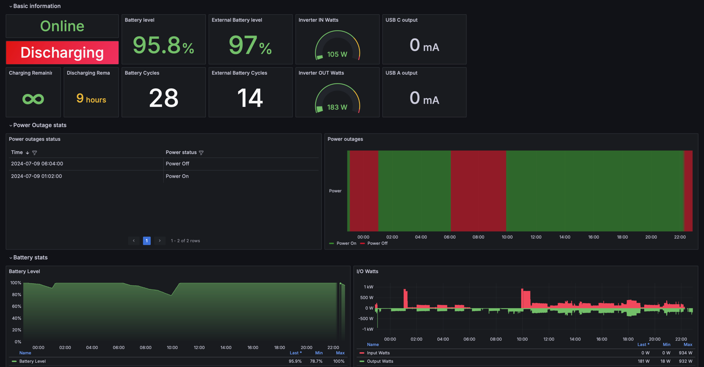

## How to run the Prometheus, Exporter and Grafana using docker-compose

1. Go to docker-compose folder: `cd docker-compose`
2. Update `.env` file with two mandatory parameters:
    - `PROMETHEUS_ENABLED` - true (or 1) if you want to enable integration with Prometheus. Default value is false
    - `EXPORTER_TYPE` - the type of exporter you'd like to use. Possible values: `rest` and `mqtt`. Default value
      is `rest`.

   If  `EXPORTER_TYPE=rest` is selected, then provide values for the following parameters:
    - `ECOFLOW_ACCESS_KEY` - the access key from the Ecoflow development website
    - `ECOFLOW_SECRET_KEY` - the secret key from the Ecoflow development website

   If  `EXPORTER_TYPE=mqtt` is selected, then provide values for the following parameters:
    - `ECOFLOW_EMAIL` - your email address that you use to log in to the Ecoflow mobile app
    - `ECOFLOW_PASSWORD` - your ecoflow password
    - `ECOFLOW_DEVICES` - the list of devices serial numbers separated by comma. For instance: `SN1,SN2,SN3`. Instead
      of `ECOFLOW_DEVICES` you can specify `ECOFLOW_DEVICES_PRETTY_NAMES` which will also work. You can specify both
      parameters if you wish.

3. (OPTIONALLY) Update other variables if you need to:
    - `METRIC_PREFIX`: the prefix that will be added to all metrics. Default value is `ecoflow`. For instance
      metric `bms_bmsStatus.minCellTemp` will be exported to prometheus as `ecoflow.bms_bmsStatus.minCellTemp`. With
      default value `ecoflow` you can use Grafana Dashboard with ID `17812` without any changes.
    - `SCRAPING_INTERVAL` - scrapping interval in seconds. How often should the exporter execute requests to Ecoflow
      Rest API in order to get the data. Default value is 30 seconds. Align this value
      with `docker-compose/prometheus/prometheus.yml`
    - `MQTT_DEVICE_OFFLINE_THRESHOLD_SECONDS` - the threshold in seconds which indicates how long we should way for a
      metric message from MQTT broker. Default value: 60 seconds. If we don't receive message within 60 seconds we
      consider that device is offline. If we don't receive messages within the threshold for all devices, we'll try to
      reconnect to the MQTT broker (there is a strange behavior that MQTT stop sends messages if you open Ecoflow mobile
      app and then close it).
    - `ECOFLOW_DEVICES_PRETTY_NAMES` - the key/value map of custom names for your devices. Key is a serial number, value
      is a device name you want to see in Grafana Dashboard. It's helpful to see a meaningful name
      in Grafana dashboard instead of a serial number.
      Example: `ECOFLOW_DEVICES_PRETTY_NAMES={"R33XXXXXXXXX":"My Delta 2", "R33YYYYY":"Delta Pro backup"}`
    - `DEBUG_ENABLED` - enable debug log messages. Default value is "false". To enable use values `true` or `1`
    - `GRAFANA_USERNAME` - admin username in Grafana. Default value: `grafana`. Can be changed later in Grafana UI
    - `GRAFANA_PASSWORD` - admin password in Grafana. Default value: `grafana`. Can be changed later in Grafana UI
    - `PROMETHEUS_METRIC_TTL_SECONDS` - drop device series that were not updated for this many seconds (for
      example parameters of a removed extra battery). Default `0` keeps them forever. The `online` series is never
      dropped. Note that in MQTT mode the exporter re-sends the last known value of every parameter, so only series of
      offline devices expire.
    - `HANDLER_QUEUE_SIZE` - how many pending updates each output (Prometheus, TimescaleDB, Redis) may buffer before
      new updates are dropped with a warning. Default value: `256`
    - `HANDLER_TIMEOUT_SECONDS` - maximum time an output may spend on one update. Default value: `30`
    - `LOG_LEVEL` - `debug`, `info`, `warn` or `error`. Overrides `DEBUG_ENABLED`. `LOG_FORMAT=json` writes
      structured logs instead of text
    - `HANDLER_UNHEALTHY_AFTER_SECONDS` - report the exporter as unhealthy (`/healthz`, Docker health status) when an
      output keeps failing for this many seconds. Disabled by default
    - `ECOFLOW_SECRET_KEY_FILE`, `ECOFLOW_PASSWORD_FILE`, `TIMESCALE_URL_FILE`, `REDIS_PASSWORD_FILE` - read the value
      from a file (Docker secrets). The plain variable wins when both are set
4. Save `.env` file with your changes.
5. Start all
   containers: `docker-compose -f docker-compose/grafana-compose.yml -f docker-compose/exporter-remote-compose.yml -f docker-compose/prometheus-compose.yml up -d`
     ```
   CONTAINER ID   IMAGE                                COMMAND                  CREATED          STATUS         PORTS                                         NAMES
   93c9cf317861   docker-compose-go_ecoflow_exporter   "/app/ecoflow-export…"   6 seconds ago    Up 5 seconds   0.0.0.0:2112->2112/tcp, :::2112->2112/tcp     go_ecoflow_exporter
   fea150b4ef5d   grafana/grafana                      "/run.sh"                16 minutes ago   Up 5 seconds   0.0.0.0:3000->3000/tcp, :::3000->3000/tcp     grafana
   823c6adfad90   prom/prometheus                      "/bin/prometheus --c…"   16 minutes ago   Up 5 seconds   0.0.0.0:9090->9090/tcp, :::9090->9090/tcp     prometheus
   ```
6. The services are available here:
    - http://localhost:2112/metrics - the exporter
    - http://localhost:2112/healthz - the exporter health: `200 ok`, or `503` when the MQTT broker is not connected /
      the EcoFlow REST API has failed for 3 scraping intervals in a row (used by the Docker `HEALTHCHECK`).
      It is also served when Prometheus is disabled (TimescaleDB or Redis only), on `PROMETHEUS_PORT`
    - http://localhost:9090 - Prometheus
    - http://localhost:3000 - Grafana

7. Navigate to http://localhost:3000 in your web browser and use GRAFANA_USERNAME / GRAFANA_PASSWORD credentials from
   .env file to access Grafana. It is already configured with prometheus as the default datasource and comes with
   the "EcoFlow" dashboard (folder EcoFlow, from `grafana_dashboards/`) showing device status, battery, power and the
   exporter health. Parameter names differ between device models, so some panels may stay empty for your device.
   You can also import the community dashboard: Dashboards → Import dashboard → import ID `17812`, select the only
   existing Prometheus datasource.
   (The Grafana dashboard was implemented
   in https://github.com/berezhinskiy/ecoflow_exporter/tree/master/docker-compose)

## Dashboard example



## Exporter metrics

Besides the device parameters, the exporter reports its own state (with the default prefix):

| Metric | Description |
|---|---|
| `ecoflow_exporter_mqtt_connected` | 1 when connected to the EcoFlow MQTT broker |
| `ecoflow_exporter_last_message_timestamp_seconds{device,serial_number}` | Unix time of the last parameters received from the device |
| `ecoflow_exporter_mqtt_messages_total{serial_number,format}` | MQTT messages received, by format (`json`, `protobuf`, `unknown`) |
| `ecoflow_exporter_decode_errors_total{serial_number,format}` | MQTT messages that could not be decoded |
| `ecoflow_exporter_mqtt_pings_total{serial_number,type,result}` | Keepalive pings and state refresh requests |
| `ecoflow_exporter_mqtt_forced_reconnects_total` | Reconnects forced because no device sent data |
| `ecoflow_exporter_rest_requests_total{endpoint,result}` | EcoFlow REST API calls |
| `ecoflow_exporter_handler_dropped_total{handler}` | Updates dropped because an output was too slow |
| `ecoflow_exporter_handler_duration_seconds{handler}` | Time spent by each output per update |
| `ecoflow_exporter_handler_errors_total{handler}` | Updates an output failed to store (network errors are retried once) |
| `ecoflow_exporter_handler_last_success_timestamp_seconds{handler}` | Unix time of the last update an output stored |

For example, alert when a device stopped reporting for 10 minutes:
`time() - ecoflow_exporter_last_message_timestamp_seconds > 600`

Alert when TimescaleDB or Redis stops accepting data:
`increase(ecoflow_exporter_handler_errors_total[15m]) > 0`
